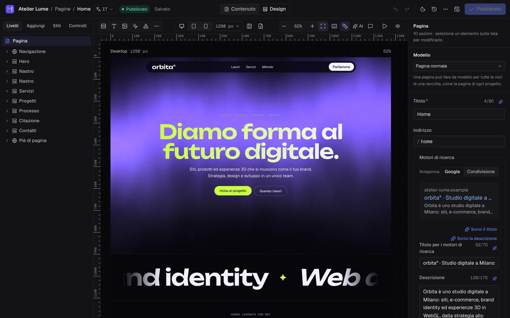
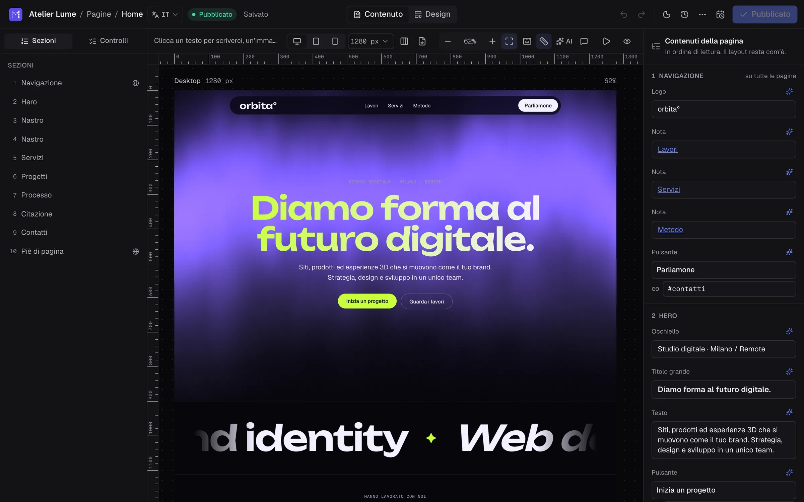
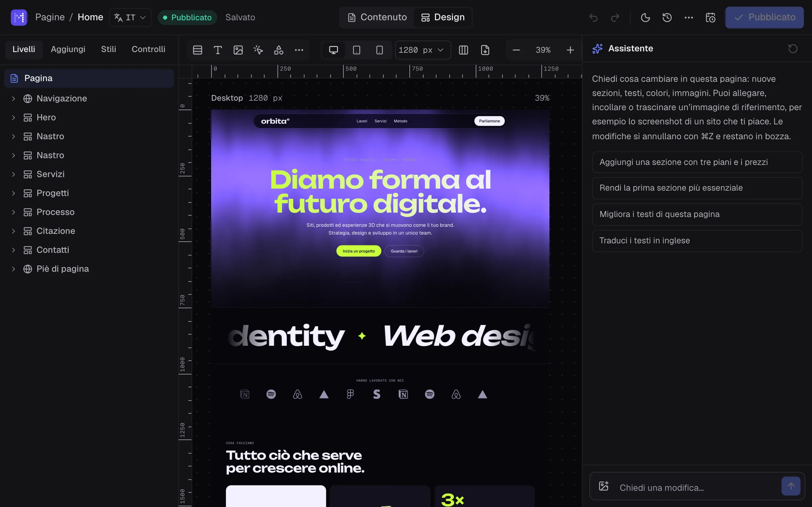
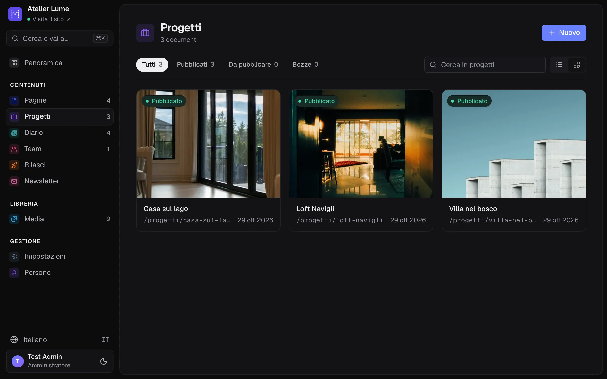
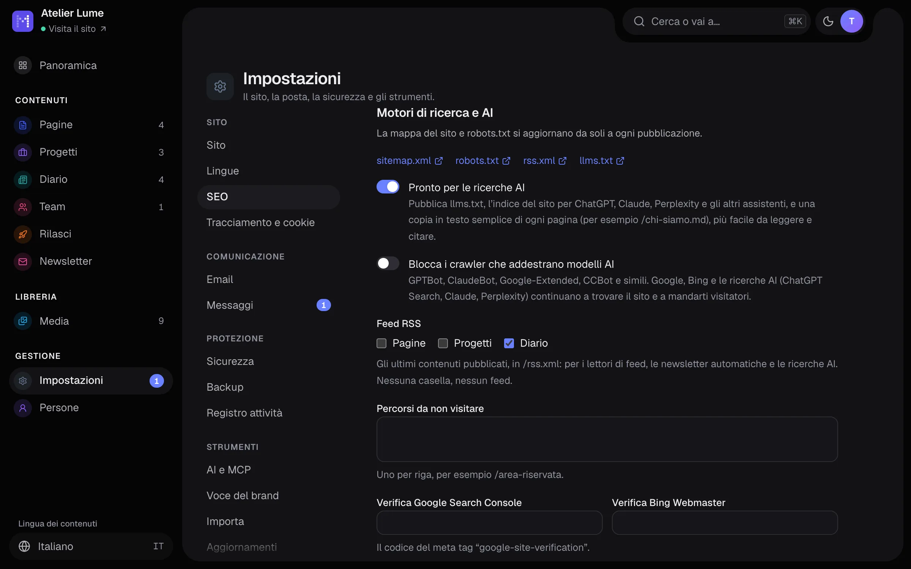
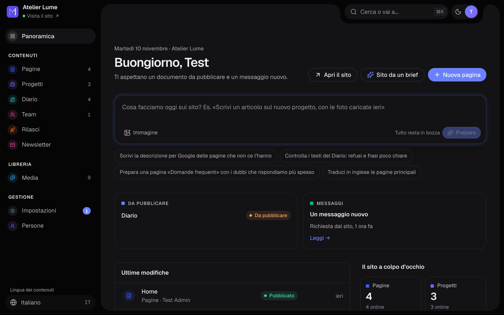
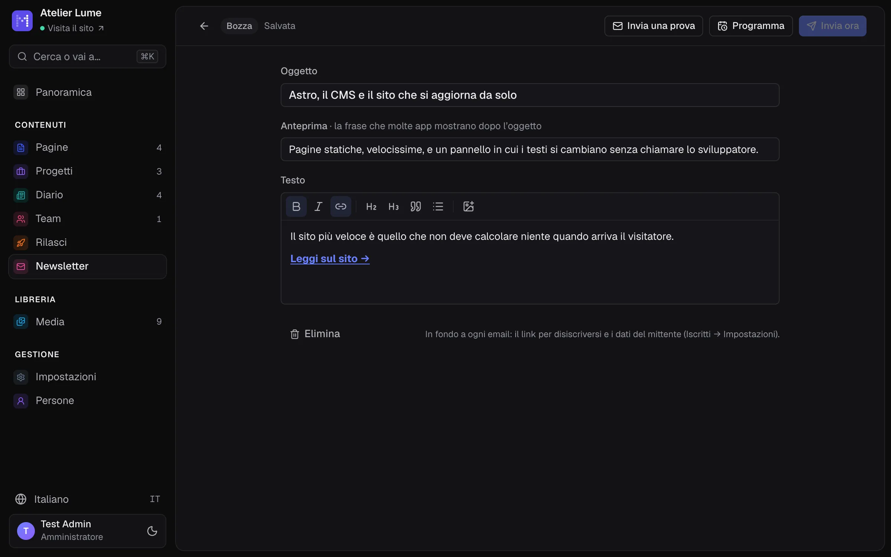
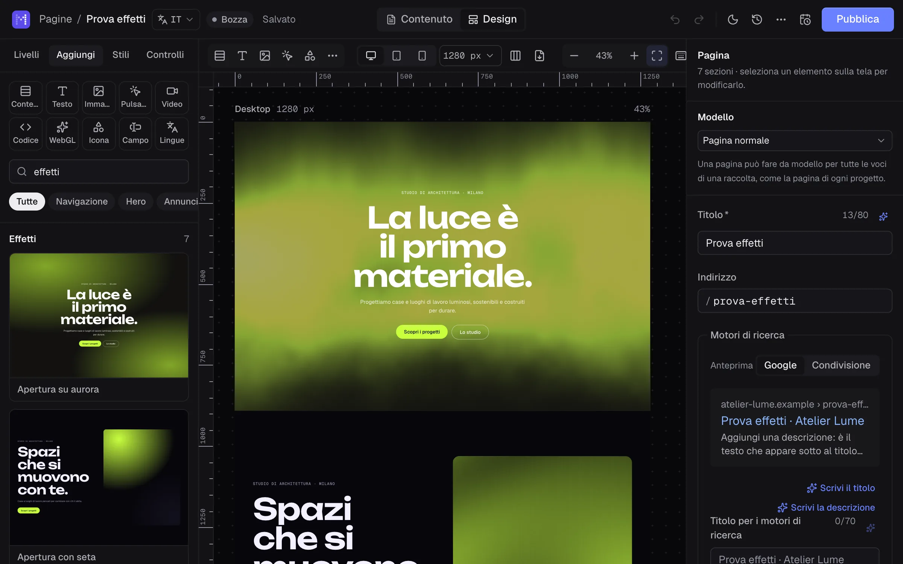

**English** · [Italiano](README.md)

<h1>
  <picture>
    <source media="(prefers-color-scheme: dark)" srcset="docs/assets/logo-wordmark-dark.svg">
    
  </picture>
</h1>

An open source CMS for agencies and freelancers: content schema in code, a visual editor on the canvas, and very fast static sites.

> Status: **Alpha**. What's new in each version is in [CHANGELOG.md](CHANGELOG.md) (in Italian).

**If you use Materialize**, read the [guide](docs/guide/README.md): installation, editor, content, languages, SEO, people, updates and backups. This README is for developers.

**Choosing a CMS?** The [comparison with WordPress, Webflow, Strapi, Sanity, Ghost and others](docs/confronto.md) (in Italian) tells you when Materialize is a good fit, and when it isn't.

## What it looks like



<table>
  <tr>
    <td width="50%"><br><sub>Content mode: change texts and images, and the design stays as it is</sub></td>
    <td width="50%"><br><sub>Checks: search engines, accessibility and performance</sub></td>
  </tr>
  <tr>
    <td width="50%"><br><sub>The AI assistant edits the page on request</sub></td>
    <td width="50%"><br><sub>Collections: projects, articles, people</sub></td>
  </tr>
  <tr>
    <td width="50%"><br><sub>SEO and AI search: llms.txt, RSS feed, crawlers</sub></td>
    <td width="50%"><br><sub>The overview: what needs doing, and one AI request across the whole site</sub></td>
  </tr>
  <tr>
    <td width="50%"><br><sub>Newsletter: write it, test it on yourself, send or schedule it</sub></td>
    <td width="50%"><br><sub>Effects: animated backgrounds, 3D logos and objects as ready-made sections</sub></td>
  </tr>
</table>

## A new site

You need Node 24 or later. There's no database to install: SQLite is included.

```bash
npm create materialize@latest
```

The command asks for a folder, copies a starter Astro site (you build pages on the canvas from the library's sections), installs the dependencies and tells you how to start: `npm run dev`, then http://localhost:4321/admin.

### Where to install it

With the panel, Materialize is a Node program that is always running, so you need **your own server**: a VPS (Hetzner, DigitalOcean, OVH, Aruba Cloud…) or a Docker environment. **Shared PHP hosting won't work**, even plans with Node in cPanel: little memory and processes suspended when there are no visits make site builds and images slow. The generated site, on the other hand, is plain static files, so you can also publish it on any static host.

### Installing on a VPS

On a fresh VPS with Debian 12 or Ubuntu 22.04 (or newer), at least 1 GB of memory and a domain pointing to its IP address, one command does it:

```bash
curl -fsSL https://cdn.jsdelivr.net/npm/@materializecms/cli/install.sh | sudo bash -s -- --domain example.com
```

The script installs Node.js and Caddy, which serves the site over HTTPS with a Let's Encrypt certificate that renews itself. It then creates the site in `/srv/materialize` and runs it as a service that restarts with the server and after a crash. Finally it opens only SSH, HTTP and HTTPS in the firewall, turns on the system's security updates and, on low-memory servers, adds swap. At the end it prints the link to finish the installation in the browser.

Run it again and it repairs the installation and prints the link again, without touching the site or its content. `--help` lists the options: Let's Encrypt email, version, folder, port, another npm registry, firewall. Environment variables for the site, such as `ANTHROPIC_API_KEY`, go in `/etc/materialize/env`; then run `systemctl restart materialize`. Read the log with `journalctl -u materialize -f`.

The service passes the site the settings that depend on the server rather than the site, through the environment: `MATERIALIZE_SITE_URL`, `MATERIALIZE_PORT`, `MATERIALIZE_HOST` and `MATERIALIZE_TRUST_PROXY`. They also work outside the script, and `materialize.config.ts` stays the same everywhere.

### With Docker

On a server that already has Docker, `docker/compose.yaml` starts Materialize behind Caddy, which handles HTTPS. The domain must already point to the server:

```bash
curl -fsSLO https://cdn.jsdelivr.net/npm/@materializecms/cli/compose.yaml
echo "DOMAIN=example.com" > .env
docker compose up -d
docker compose logs materialize
```

The `.env` file remembers the domain for every later command (`docker compose logs`, `stop`, `run`…). The log contains the link to finish the installation in the browser. On its own, without Caddy:

```bash
docker run -d --name materialize -p 4321:4321 -v materialize:/site --restart unless-stopped ghcr.io/materializecms/materialize
```

**The `/site` volume:**
- holds the whole site, from packages to content;
- updates are installed from the panel and stay in the volume;
- if you recreate the container, even from an older image, the site starts again from the version it had;
- the image is only used to create the site on first start.

Pass environment variables for the site (`ANTHROPIC_API_KEY`, `MATERIALIZE_SITE_URL`…) to the container.

### Setup in the browser

On first start the panel walks you through setup in three steps: it checks the server (Node version, writable folders, site, HTTPS, updates), asks for the site's name and language, creates the administrator account, then opens the panel.

In production (`materialize start`) setup requires the link the server prints at startup, `/admin/?installa=<code>`, so a server that just went online can't be claimed by whoever finds it first. The code stays the same if the server restarts (it lives in `.materialize/install-code`) and disappears once setup is done. In development (`materialize dev`) it isn't needed.

### Updates

With `materialize start`, the server runs under a small supervisor that keeps it running (restarting it if it stops) and applies updates. Once a day the server checks for a new version. Administrators see it in a pill at the top right and on the Overview, and in **Settings → Updates** with the changelog notes, and installs it with one click:

1. the database and media are backed up;
2. the new version downloads into `.materialize/updates/next` while the site stays online;
3. the server restarts on the new version, which must start and build the site; if it can't, the previous version comes back on its own;
4. the previous version stays in `.materialize/updates/previous`, so you can go back with one click.

You can let fixes install themselves (same major and minor version, for example 0.2.0 to 0.2.1); new features are always the administrator's call. The server must be able to write to the site folder and find `npm`. Without the supervisor (`--no-supervisor`, or another program launching the server) and in development, the panel shows the command to run by hand. Site files (layouts, blocks, configuration) are never touched.

## Developing Materialize

```bash
npm install
npm run dev
```

The first time, `npm run dev` creates `sito-locale/` from the starter site, the same one people get with `npm create materialize`. The folder stays on your computer and git ignores it: the repository contains no sample sites or content. The site runs at http://localhost:4321 and the panel at http://localhost:4321/admin. On first visit you create the administrator account right in the panel. Site, panel and API all live at the same address.

## The panel

- **Content**: forms generated from the schema, with a prominent title, a rich text editor, images with a focal point, relations, reorderable blocks and a search engine preview.
- **Design**: the real page on the canvas, drawn by the site's components, with layers, an inspector, editing text right on the page, and desktop, tablet and mobile previews. Drag blocks on the page to move them. Every change shows up at once: only the block that changed is redrawn.
- **Per-block style**: background, space above and below, entrance animation (with preview) and an anchor for internal links. The choices are names from the site's theme, not free colors, so pages stay consistent no matter who edits them.
- **Drafts are always safe**: autosave while you type, even if the page is incomplete. You publish only when everything is in order, and the panel takes you straight to the fields that need fixing.
- **Scheduled publishing**: the calendar button next to **Publish** lets you pick when a page goes live (with shortcuts like "Tomorrow at 9") and, if needed, when it goes back to draft on its own, for a sale or an event. The draft goes out as it is at that moment, under the name of whoever scheduled it. Missing fields are flagged right away. If the page is no longer complete when it's due, it isn't published and the panel explains why. A server that was off at that time catches up as soon as it restarts. Lists show the date next to the status, and the AI can schedule with the `schedule_entry` MCP tool.
- **One editor per document**: if you open a document someone else is editing, you see it read-only, with who is working on it and for how long. You can go back, open the site, or take over (the other person sees it at once). The turn renews every few seconds and frees itself; the server rejects saves from whoever doesn't hold the turn, even from another tab of the same person. API `POST` · `DELETE /api/documents/:id/turn`.
- **Panel tour**: the first time, a tour highlights one area at a time (overview, AI request, things to do, content, releases and newsletter, media, settings, ⌘K search, profile). Run it again from the profile menu or by searching for "tour". It uses the same component as the editor tour, which skips steps for things that aren't there (for example when AI is off).
- **Newsletter** (sidebar → Newsletter): sign-ups from the site with double opt-in by email (two ready-made sections in the library, or any form set to **Signs up to the newsletter**), and a subscriber list with CSV import from Mailchimp or Brevo and export. Newsletters can start empty, from an article, or be written by the AI from the latest articles in the brand voice. Test on yourself, send now or schedule; emails go out one at a time and resume after a restart. Every email has an unsubscribe link (including one-click from the mail app, RFC 8058) and the sender's details. Open and click stats, with signed links, can be turned off. It uses the email from Settings → Email. API `/api/newsletters`, `/api/subscribers`.
- **Releases** (sidebar → Releases, or More actions → Add to a release): several pages and articles that go live together, now or at a set time, plus old pages to take down at the same moment. All or nothing: if one page isn't ready, nothing goes out, and the panel says which one and why. A page belongs to one release at a time; canceling a release leaves the pages as they are. API `/api/releases`, MCP tools `list_releases`, `create_release`, `add_to_release`, `publish_release`, `schedule_release`.
- **Shareable preview links**: More actions → Share preview creates a secret link that shows the draft with the site's real design to someone without an account, like a client or a colleague. It lasts 1, 7 or 30 days, or until you revoke it. It follows your edits, since it always shows the latest saved version. It carries a "Preview" label, isn't indexed by search engines and doesn't count in analytics. The panel shows how many times it was opened, and the AI can create one with the `share_preview` MCP tool.
- **Page checks** (the editor's Checks tab): search engines, **accessibility** (text contrast measured on the canvas against the WCAG 4.5:1 and 3:1 rules, images without a description, unnamed buttons, icons and fields, vague links, skipped heading levels, videos without pause) and **performance** (files from other sites, heavy GIFs and videos, videos without a poster, too many 3D scenes, external scripts, too many fonts, huge pages). One click selects the element to fix. Before publishing, serious problems are listed with **Publish anyway**.
- **SEO and AI search** (Settings → SEO): titles, descriptions, social previews and structured data (business, articles, events, FAQs) on every page; `sitemap.xml` and `robots.txt` updated on every publish; automatic redirects when an address changes. The **`/rss.xml`** feed collects the latest articles (by default the collections with pages and a date, or the ones you pick). For ChatGPT, Claude, Perplexity and other assistants there's **`/llms.txt`**, the site index with a summary of each page, plus a Markdown copy of every indexable page (`/chi-siamo.md`, `/index.md` for the home page), written during the build and announced in the page head. You can block crawlers that train AI models without losing AI search, which sends visitors.
- **Media**: a library with drag-and-drop upload, search, alt text and a count of the pages that use each image. From an image field you can upload, pick from the library or drop a file.
- **People**: administrators invite editors and other administrators with a link valid for 7 days, change roles, remove access and create new-password links (24 hours). There's always at least one administrator. Everyone changes their own name and password in their profile.
- **Forgot password**: from the sign-in page, a link valid for one hour arrives by email. The response is the same for every address, so nobody can tell who is registered, and requests are rate-limited per email and per IP address. The link always uses the site's public address (`site.url` or `MATERIALIZE_SITE_URL`), never the one claimed by the request: online, without that address the link is not sent (locally it is) and Settings → Security points it out. A password changed with the link ends the sessions and revokes the personal access tokens. Without email set up, the page explains who can help: an administrator, or whoever runs the server with `materialize reset-password <email>`, which prints the link.
- **Import from WordPress** (Settings → Import): posts, pages, images, categories and SEO, from the site's address (drafts too, with an application password) or from the export file. It works with Gutenberg, Elementor, WPBakery, Divi and the other builders. Images go into the library, internal links point to the new pages and old addresses get a 301 redirect. Pages arrive with their content in order and image descriptions. You redo the layout on the canvas, or, with **Redo the pages' layout with AI**, the AI rebuilds it from the library's sections, in the draft and with the same texts and images (checked afterward: if they would change, the page stays as it was).
- **History**: every save is a version, with the name of whoever made it. For canvas pages, the History button lists the versions; click one to see it on desktop, tablet and mobile before restoring it. A restore goes into the draft and ⌘Z undoes it. For entries edited through fields, history is in the document panel.
- **Export to PDF or PNG** the page as it is now, even unpublished, to send to a client: desktop, tablet and mobile, each as a single long image (in the PDF, one page per device, with name, device and date).
- Undo and redo (⌘Z, ⇧⌘Z), search and commands (⌘K), light and dark theme, content languages.
- **Panel languages**: English and Italian. Each person picks the language in their profile or on the sign-in page; until they do, the panel follows the browser. Server messages and emails to people with an account come in the same language. The terminal speaks the system's language, or the one in `MATERIALIZE_LANG` (`it` or `en`). Site content has its own languages, separately.
- **Panel look**: rounded surfaces on a dark shell, pill-shaped controls, and toolbars set into notches in the frame (search and profile at top right, canvas controls at the top of the canvas, zoom at bottom right).
- **AI assistant** (optional, Settings → AI and MCP): with a Claude API key, or an OpenAI-compatible server such as Ollama. The ✨ button next to texts rewrites, shortens, lengthens, corrects, changes the tone or translates. It also works on articles' rich text, keeping headings, lists, bold and links, and the result respects the field's maximum length. The AI writes the title and description for Google, describes images (keeping any photo credit already there, for example "photo by … on Unsplash"), translates a whole page into another language and, in the editor, changes the page from a plain-language request, even starting from a reference image (a screenshot, a mockup, a sketch) attached, pasted or dropped into the chat. Changes stay in the draft and one ⌘Z undoes them. Quick actions (✨, SEO, alt text) use a cheaper model, Claude Haiku 5.5 unless you pick another; the assistant and page translations stay on the main model. With Claude, the assistant uses prompt caching: instructions, tools and the page, which repeat at every step, cost a fraction after the first. Settings → AI and MCP shows the month's usage: requests, tokens read (and how many from the cache) and written.
- **Requests from the overview**: the "What shall we do on the site today?" field sends the AI a request across the whole site (Google descriptions, proofreading, new pages, translations). It works only in drafts: it doesn't publish, schedule, or change the theme or shared sections. It lists the drafts it touched for you to review, and you can reply to ask for more. API `POST /api/ai/studio` (streamed events).
- **Site from a brief** (Overview → Site from a brief, for administrators): a few lines about the business and, if you like, up to two reference images. The AI reads the library and prepares 1 to 8 draft pages from the library's sections, with the same navigation and footer linking them together, text in the site's language, and a title and description for Google. It uses only the facts in the brief: missing ones stay as placeholders in [square brackets]. It doesn't touch existing pages, shared sections, the theme or the live site. Colors and fonts (and the brand voice, if there isn't one yet) are a proposal, with **Apply the theme** and **Save the voice**. You can reply to the AI in the same window to ask for more. API `POST /api/ai/site` (streamed events).
- **Brand voice** (Settings → Brand voice): who you are and who you write for, tone (up to three), form of address, words to use and avoid, rules and a sample text. When the AI writes from scratch (Google texts, plain-language requests, the assistant, MCP: `get_site` returns it) it uses the whole voice. When it changes text someone wrote (rewrite, shorten, lengthen, tone, translations) it uses only the style, so it doesn't add facts. For corrections and alt text, none of it. **Work it out from the site's texts** proposes a voice by reading the published pages. API `GET` · `PUT /api/voice` and `POST /api/voice/suggest`.
- **AI review before publishing** (Checks tab, or More actions → AI review for articles): the AI rereads the draft as it is in the editor and flags typos, grammar, sentences off the brand voice, inconsistencies (prices, dates, names) and links whose words don't match the destination page, whose title it receives. Each finding has the exact words and the fix; findings the AI quotes inaccurately are dropped. **Apply** changes the draft as a single undoable step. It runs only on request. API `POST /api/documents/:id/review` and `…/review/apply`.
- **MCP**: Claude Desktop, Claude Code and other AI clients work on the site with a personal token, with the same permissions as the person who created it (Settings → AI and MCP → Access tokens).
- **About Materialize** (Settings → About): installed version, author, MIT license, what's new, guide, source code, issue reporting and the licenses of third-party code bundled in the panel. The sign-in page links to the project without showing the version: a public page shouldn't reveal which version is installed.

Without a connected Astro site, the canvas uses a neutral style that shows structure and content.

## The site

The site is an [Astro](https://astro.build) project next to `materialize.config.ts`. A few conventions are all it takes:

- **One component per block type** in `src/blocks`, named after the block: `ProjectsGrid.astro` renders `projectsGrid` blocks. It receives the block's fields and `field(name)`: put it on the element that shows a text (`<h1 {...field('title')}>`) and editors can edit it right on the canvas.
- **A layout** in `src/layouts/Site.astro`, used by pages and by the preview.
- **One route for all pages**: in `src/pages/[...path].astro`, `export const getStaticPaths = getRoutes` creates a page for every published document that has an address. The same route renders shared preview links: it receives `entry` as a prop, so the draft shows up with the real design (for a different route, use the `page` option of `materialize()`).
- **Feed, llms.txt and robots.txt** come from the integration; a file with the same name in `src/pages` or `public/` takes precedence.

```astro
---
import Blocks from '@materializecms/astro/components/Blocks.astro'
import { getRoutes } from '@materializecms/astro/content'
import Site from '../layouts/Site.astro'

export const getStaticPaths = getRoutes
const { entry } = Astro.props
---

<Site title={entry.title} entry={entry}>
  <Blocks blocks={entry.data.blocks} />
</Site>
```

### Images

Uploaded images lose their camera metadata (GPS location included) and are straightened. The `Media` component serves them as AVIF and WebP in several widths (`/media/foto.jpg@960.avif`), so each device downloads only what it needs. Variants are created on first request and cached in `.materialize/media`. With `materialize build`, the images used by the pages end up in `dist/client`, ready for any host.

### Block styles

Each block can have `_style` with `background` (`default`, `muted`, `dark`, `accent`), `spacing` (`none`, `compact`, `normal`, `spacious`), `animation` (`fade`, `rise`, `zoom`, `slide`) and `anchor`. `Blocks` turns them into CSS variables on the block's wrapper; the site decides what they mean by defining `--theme-muted-bg`, `--theme-dark-bg`, `--theme-dark-fg`, `--theme-accent-bg` and so on. Components read `--mz-bg`, `--mz-fg` and `--mz-space` with their own defaults. Animations start on scroll, in pure CSS, and don't run for people who asked for reduced motion.

In templates, relations arrive already resolved: a `relation` field contains the linked documents, with title, address and data. For everything else there are `getEntries`, `getEntry`, `getSingleton` and the `RichText` and `Media` components (images with a focal point).

In development, pages are generated on every request, so a publish shows up immediately. In production (`materialize start`) the site is static files and rebuilds itself after every publish, usually in under a second: the new version replaces the old one only when it's complete.

### Analytics, tags and cookies

In **Settings → Tracking and cookies** an administrator adds Google Analytics 4, Google Tag Manager, Meta Pixel, Plausible or Matomo with just the ID, plus any other code for the `<head>` or the end of the `<body>`, choosing what it's for: necessary, analytics or marketing. The `Tracking` component (already in new sites' layout: `<Tracking lang={entry?.locale} />` in the `<head>`) adds it to every published page, never to the editor preview.

Analytics and marketing code stays blocked until the visitor accepts: a banner with Reject, Customize and Accept all appears on its own, and Google Consent Mode starts as "denied". The choice lasts a year. Visitors change it from the small button at bottom left, from a link to `#preferenze-cookie` (in the footer, for example) or from an element with `data-mz-consent-open`. You still need to write the site's privacy and cookie policy.

## The page editor

You build pages on the canvas from sections and elements (containers, texts, images, buttons, videos, code, WebGL scenes), starting from a library of more than 100 sections, including the **Effects** category: heroes on animated backgrounds, 3D logos and objects, a globe, images that bend with the mouse, calls to action on particles. Every element has:

- **free-form design**: row, column or grid layout, free positioning and layers, colors and gradients, per-element typography, borders, shadows, blend modes, filters and a glass effect, with separate edits for tablet and mobile;
- **interactions**: on load, on entering the viewport, on scroll, on hover or mouse move, on click; text that enters word by word or letter by letter, counters, parallax, elements pinned during scroll, scrolling marquees;
- **timelines**: each interaction can have multiple keyframes, each with its own easing curve, to try out on the canvas with the timeline scrubber;
- **WebGL scenes**: 21 shaders (backgrounds, motion, image effects) plus one hand-written in GLSL, 3D shapes and glTF models (.glb files uploaded to the media library) with chrome, glass, iridescent, clay or wireframe materials; three.js loads only on pages that have a 3D scene;
- **components**: an element becomes reusable, with multiple variants; the design applies to every copy, while texts, images and links belong to each copy;
- **data**: a container can repeat for each entry in a collection (the projects, for example), sorted and filtered by field, with a "Show more" button; global sections, like the menu and footer, apply to every page;
- **shared text styles**: a named style (font, sizes per device, color) is created from one text and applied to others; change it and they all change.

- **icons and shapes**: line icons (arrows, contacts, social…), solid shapes (arch, circle, wave…) and pasted SVGs, cleaned of scripts;
- **hover states**: colors, scale, offset, shadow, even when the pointer is over the card that contains the element; component copies can switch to another variant;
- **named colors** in the theme (one for light, one for dark) and configurable tablet and mobile **breakpoints**;
- **template pages**: a page can act as the template for every entry in a collection (each project's page), with a preview on a real entry;
- **contact forms**: real fields (including **file attachments**, up to 10 MB, kept private), submission without a page reload (and without JavaScript too), messages in Settings → Messages and by email via SMTP. The server rechecks the published form's fields (required, email, choices, file type and size) and says next to the field what's wrong. **Spam protection without CAPTCHAs**: honeypot field, minimum fill-in time, too many or hidden links, repeated messages; spam goes to a separate folder and can be recovered. Per form: name, recipients, **auto-reply** to the sender and a signed **webhook** (HMAC SHA-256) for Zapier, Make or n8n; only an administrator can change recipients and webhooks. Messages can be filtered by form, unread and spam, with search, **CSV export** and **automatic deletion** after 6, 12 or 24 months (GDPR); the consent checkbox can open the privacy notice. With email set up, invitations and password resets arrive by mail too;
- **easy email setup** (Settings → Email):
  - pick the provider (Brevo, Postmark, Resend, Mailgun, Amazon SES, SendGrid, Mailjet, SMTP2GO, Aruba, Register.it, Gmail, Microsoft 365) and server, port and security fill themselves in, with a pointer to where to find the username and password;
  - if the test fails, the panel says why in plain words: server doesn't exist, port blocked by the VPS provider (with the ports that do respond), wrong security for the port, password rejected, sender not verified, limit reached;
  - **Check the domain** reads the sender's DNS and verifies SPF, DKIM and DMARC, which keep emails out of spam;
- **teamwork**: comments on elements or on the page, and who else has the page open, with the element they've selected.

On the canvas:

- ⇧-click (on the canvas or in the layers) selects multiple elements, and so does a box dragged from the empty canvas or a section's background (with ⇧, anywhere): style changes apply to all of them; ⌘A selects the neighboring elements; dragging one moves them all together;
- rulers in page pixels along the canvas edges, with the selection highlighted (⇧R shows or hides them);
- the left panel widens by dragging its edge (up to 440 px, remembered by the browser);
- test widths for each device and all devices side by side; ⌥⌘C / ⌥⌘V copies and pastes style; above the selected element, a quick-action bar (AI on text, replace image, duplicate, move, how it looks on mobile, delete); ? shows all shortcuts; the first time, a 14-step tour highlights one area of the editor at a time (opening the tabs it explains on its own), and you can run it again from the shortcuts;
- ⌘G groups the selection into a container, ⇧⌘G ungroups it; ⌘D duplicates, ⌫ deletes;
- align and distribute (⌥⌘A, ⌥⌘H, ⌥⌘D, ⌥⌘W, ⌥⌘V, ⌥⌘S): free-positioned elements move, while those in a column or row align through their container;
- dragging a free-positioned element shows snapping guides to the edges and centers of the container and nearby elements (⌘ to move it without snapping); holding ⌥ shows the distances to the element under the pointer.

Menu links to a section of the same page glide to it, and the section stops below a fixed menu. For the whole site you can also choose smooth scrolling, a custom cursor and page transitions. People who asked their device for reduced motion see a still site. Only an administrator can add custom code.

## Fonts

In the editor's **Styles** tab you can pick any Google Font (about 2,000). The files aren't loaded from Google: Materialize downloads them once from Fontsource, keeps them in `.materialize/fonts` and serves them from the site itself at `/fonts/…`, so visitors don't contact third parties. With `materialize build`, the fonts in use end up in `dist/` along with the pages.

## The schema is code

Content is defined in `materialize.config.ts`, with TypeScript types inferred automatically:

```ts
import { defineBlock, defineCollection, defineConfig, f } from '@materializecms/core'

const hero = defineBlock({
  name: 'hero',
  fields: {
    title: f.text({ required: true, max: 90 }),
    image: f.media({ focalPoint: true }),
  },
})

const pages = defineCollection({
  name: 'pages',
  url: (page) => `/${page.slug}`,
  fields: {
    title: f.text({ required: true }),
    slug: f.slug({ from: 'title' }),
    blocks: f.blocks([hero]),
    seo: f.seo(),
  },
})

export default defineConfig({ site: { name: 'Il mio sito' }, collections: [pages] })
```

With `materialize dev`, every save of the schema reloads without a restart. If the schema has an error, the server stays on the previous version and explains what to fix.

Available fields: `text`, `richText`, `number`, `boolean`, `date`, `select`, `slug`, `media`, `link`, `relation`, `blocks`, `group`, `array`, `seo`, `color`, `json`.

## Structure

| Folder                        | Contents                                                                                                     |
| ----------------------------- | ------------------------------------------------------------------------------------------------------------ |
| `packages/core`               | Schema as code: collections, blocks, fields, types, validation, description for the admin                    |
| `packages/db`                 | Documents with draft and published version, revisions, users and sessions (Drizzle + libSQL)                 |
| `packages/server`             | HTTP API (Hono): setup, login, content management, public API; serves the panel at `/admin`                  |
| `packages/admin`              | Admin panel (React, Tailwind, Tiptap), built with Vite                                                       |
| `packages/astro`              | Astro integration: published content for pages, components for blocks and text, draft preview for the canvas |
| `packages/cli`                | The `materialize dev` / `materialize start` command                                                          |
| `packages/create-materialize` | `npm create materialize`: copies the starter site in `template/` and installs the dependencies               |

## API

| Method and path                                                                                       | Description                                                                                                                    |
| ----------------------------------------------------------------------------------------------------- | ------------------------------------------------------------------------------------------------------------------------------ |
| `GET /api/setup` · `POST /api/setup`                                                                  | First administrator (only if none exists)                                                                                      |
| `POST /api/auth/login` · `logout` · `GET /api/auth/me`                                                | Session with a secure cookie                                                                                                   |
| `GET /api/auth/recovery` · `POST /api/auth/forgot`                                                    | Forgot password: whether email is set up, and the link by email                                                                |
| `GET /api/schema`                                                                                     | Collections and fields, to build the forms                                                                                     |
| `GET` · `POST /api/collections/:nome`                                                                 | List with search, creation with validation                                                                                     |
| `GET` · `PUT` · `DELETE /api/documents/:id`                                                           | Read, save the draft (even incomplete, with the list of fields to fix), delete (admin)                                         |
| `POST /api/documents/:id/publish` · `unpublish`                                                       | Publish the draft if it's valid, or take it off the site                                                                       |
| `PUT /api/documents/:id/schedule` · `GET /api/schedules`                                              | Schedule (or cancel, with `at: null`) when the entry goes live or back to draft; list of what's coming up                      |
| `GET` · `POST /api/documents/:id/previews` · `DELETE /api/previews/:id`                               | Draft preview links: list, create (`days`, or `null` for no expiry), revoke                                                    |
| `POST /api/forms/:id` · `GET /api/submissions` · `…/export.csv` · `…/:id/files/:n`                    | Site form submissions (JSON or multipart); messages with filters (`form`, `status=unread\|spam`, `q`), CSV export, attachments |
| `GET /api/documents/:id/revisions` · `POST …/:rev/restore`                                            | History and restore                                                                                                            |
| `GET /api/users` · `POST /api/users/invites` · `PATCH` · `DELETE /api/users/:id` · `POST …/:id/reset` | People and invitations (admin): list, invite, role, removal, new-password link                                                 |
| `GET /api/invites/:token` · `POST …/accept`                                                           | Invitation or new-password link: single use, without being signed in                                                           |
| `PATCH /api/auth/me` · `POST /api/auth/password`                                                      | Your own name and password                                                                                                     |
| `GET` · `POST /api/media` · `GET` · `PATCH` · `DELETE /api/media/:id`                                 | Media library: list and search, upload, alt text and usage, delete (admin)                                                     |
| `GET /media/:file`                                                                                    | Public images: the original, or a variant with `@width.format`                                                                 |
| `GET /api/content/:nome` · `/:slug`                                                                   | Public API: published content only                                                                                             |

Drafts don't touch the live site until you publish. Cross-site write requests are blocked (CSRF); passwords use scrypt; only the hash of session tokens is stored.

## Commands

```bash
npm run dev         # builds the panel and starts the example with schema reload
npm run dev:admin   # panel development with hot reload (with npm run dev running)
npm run build       # builds the panel

# in the site folder
npx materialize build   # generates the static site in dist/, to publish on any host
npx materialize start   # production: static site, panel and rebuild on every publish
npx materialize restore <file>   # restores a backup or the full archive (with the server stopped)
npx materialize decrypt <folder> --key mzk1-…   # decrypts backups downloaded from external storage
npx materialize reset-password <email>   # prints a new-password link, valid for one hour
npm test            # tests (Vitest)
npm run typecheck   # TypeScript 7
npm run lint        # Biome
npm run check       # all of the above
npm run audit       # known vulnerabilities in dependencies
npm run release     # prepares the npm packages in .release/ (publishes nothing)
npm run smoke       # creates, builds and starts a site with the packages in .release/
npm run bump patch  # new version for all packages (patch, minor, major or 1.2.3)
```

## Security

The panel protects itself:
- limits on failed sign-ins;
- two-step verification;
- CSP rules;
- activity log;
- in development (`materialize dev`) the server is reachable only from your computer, unless you pass `--host 0.0.0.0`; online (`materialize start`) setup requires the code printed at startup;
- daily backups of the database and images, and a full archive to download;
- an encrypted copy of the backups **off the server**, every night, on S3-compatible storage or in a WebDAV folder (see below).

HTTPS, proxies, Cloudflare and firewalls are up to whoever puts the site online: they're covered in [docs/sicurezza.md](docs/sicurezza.md) (in Italian). Each site's status is in Settings → Security; backups in Settings → Backups and the log in Settings → Activity log.

### Off-server backups

In Settings → Backups, **Off-server copy** sends the backups every night to:
- **S3-compatible storage**: Amazon S3, Cloudflare R2, Backblaze B2, Hetzner Object Storage, Scaleway, OVH, Wasabi, DigitalOcean Spaces, MinIO…
- **WebDAV**: Nextcloud, ownCloud, Synology and QNAP NAS, pCloud, kDrive…

**What gets copied:**
- every night, the latest copy of the database;
- media and fonts not yet sent: uploaded files never change, so they go out only once.

On the external storage, media are only ever added. Database copies beyond the number you choose are deleted.

**Encryption:** everything is encrypted before it leaves (AES-256-GCM, in authenticated 1 MiB chunks, with the last chunk marked, so a truncated file is rejected). The random key is the **recovery key** (`mzk1-…`): the panel shows it once on the first save, and afterward only to someone who confirms their password.

**Tests and alerts:**
- **Test the connection** writes, reads back and deletes a file;
- **Run now** makes a copy right away;
- if a nightly copy fails, administrators get an email and Settings → Security flags it.

The clients use only `fetch` and `node:crypto`, with an in-house AWS Signature Version 4 implementation checked against Amazon's official example.

**Restoring:**
1. Download the folder with any tool (the service's console, Nextcloud, `rclone`).
2. Decrypt it with `npx materialize decrypt <folder> --key mzk1-…`. In the folder of a site that still has its database, the key is read automatically; otherwise you can pass it with `MATERIALIZE_BACKUP_KEY`.
3. Put the database back with `npx materialize restore`, and copy `media/` and `fonts/` into `.materialize/`.

## Releasing a version

The packages are named `@materializecms/*`, plus `create-materialize`, and they always share the same version. User-facing changes go into [CHANGELOG.md](CHANGELOG.md) as you work, under «Prossima versione», in plain words: the panel shows them when it offers an update.

For a new version:

```bash
npm run bump patch      # or minor, major, or an exact version like 0.2.0
git commit -am "Versione 0.1.1"
git tag v0.1.1 && git push --follow-tags
```

`bump` updates the version of every package, their dependencies on each other and the lockfile, and dates the «Prossima versione» section of the changelog (it refuses if the section is empty). The tag starts the **Rilascio** workflow on GitHub: the same checks as every change, then `npm run release` (panel and packages built into `.release/`), `npm run smoke` (a new site created from those packages must install, build and start), publishing to npm with signed provenance, a GitHub release with the changelog notes, and finally the Docker image on `ghcr.io`.

Publishing to npm uses no tokens: each package, in its settings on npmjs.com (**Trusted Publisher**), trusts only the `release.yml` workflow of `materializecms/materialize` in the `npm` environment. Before publishing, the environment waits for a maintainer's approval on GitHub (**Actions → Rilascio → Review deployments**). A new package has to be published once by hand first, then you add the Trusted Publisher. If a release stops halfway, **Actions → Rilascio → Run workflow** with the tag resumes it: whatever is already on npm is skipped.

You can also do it all by hand: `npm run release`, `npm run smoke`, then `npm run publish-release`, which publishes the packages in the right order and skips those already there, so you can rerun it if it's interrupted. For a dry run without really publishing, the same command accepts a local registry (for example [Verdaccio](https://verdaccio.org)): `npm run publish-release -- --registry http://localhost:4873`, then `npm create materialize@latest` with `--registry`.

## Technical choices

- **Node 24** runs TypeScript directly: no build step in development. Published packages are compiled, though, because Node doesn't run TypeScript inside `node_modules`.
- **SQLite via libSQL**: a local file by default; a remote Turso database works with the same API (`database.url` in the config).
- **Content as validated JSON**: changing fields in the schema doesn't require database migrations.

## Next steps

In this order:

1. **Toward Beta**: a test install on a real server, sending email through real providers, the first people using it outside the project.
2. **Later**: simple selling with Stripe (not a full store), real-time editing with several people, to be evaluated first.

Extensions and plugins aren't planned for now, and neither are multiple sites in one installation. What has already shipped is in the [CHANGELOG](CHANGELOG.md).
