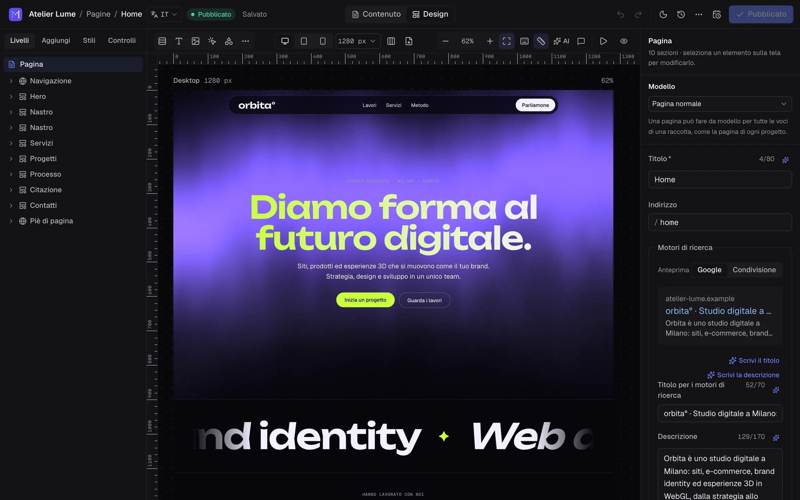
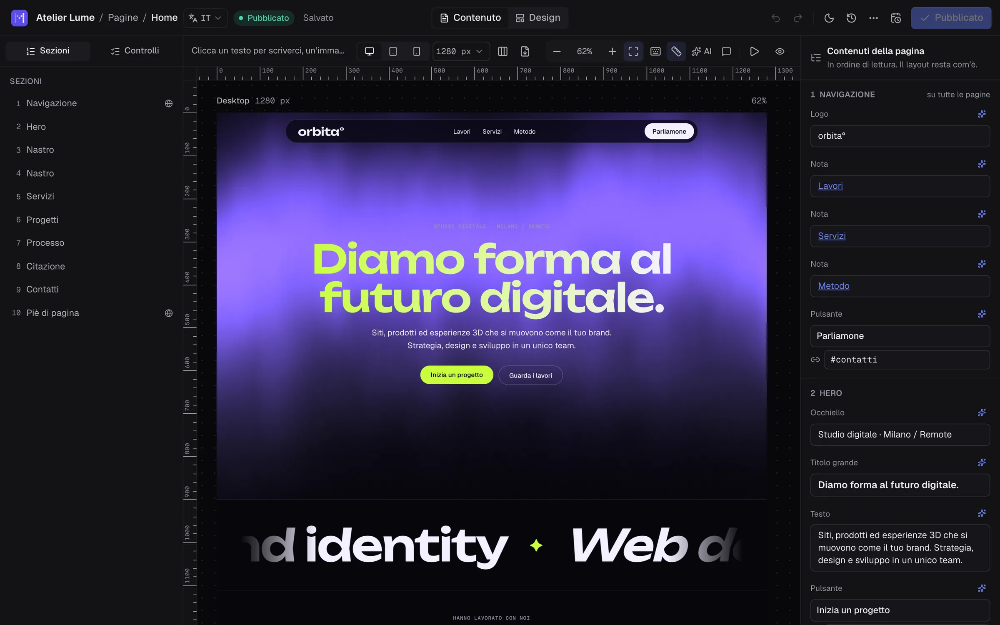
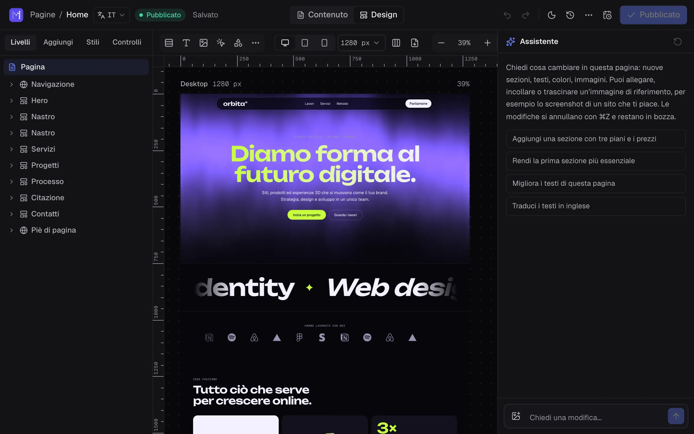
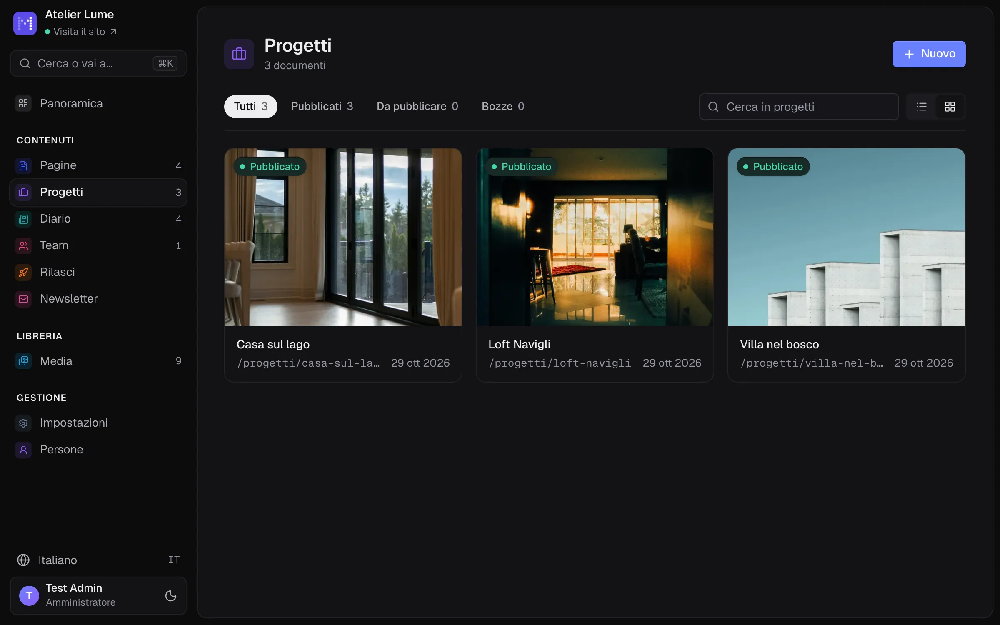
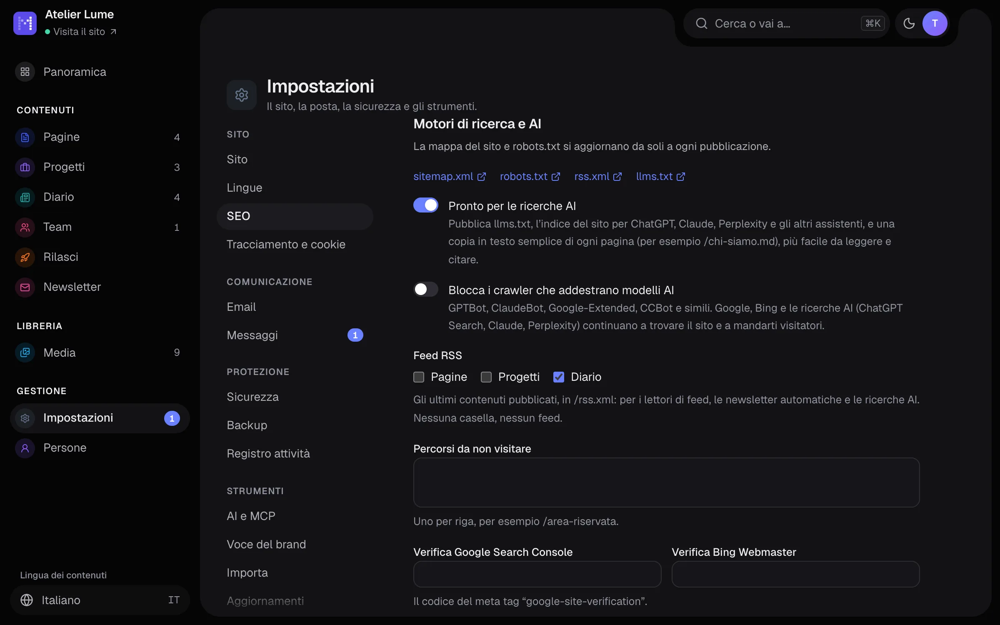

<h1>
  <picture>
    <source media="(prefers-color-scheme: dark)" srcset="docs/assets/logo-wordmark-dark.svg">
    
  </picture>
</h1>

CMS open source per agenzie e freelance: schema dei contenuti in codice, editor visuale sulla tela, siti statici velocissimi.

> Stato: **Alpha**. Le novità di ogni versione sono in [CHANGELOG.md](CHANGELOG.md).

**Per chi usa Materialize** c'è la [guida](docs/guida/README.md): installazione, editor, contenuti, lingue, SEO, persone, aggiornamenti e backup. Questo README è per chi sviluppa.

**Stai scegliendo un CMS?** Il [confronto con WordPress, Webflow, Strapi, Sanity, Ghost e gli altri](docs/confronto.md) dice quando Materialize fa al caso tuo, e quando no.

## Come si presenta



<table>
  <tr>
    <td width="50%"><br><sub>Modalità Contenuto: si cambiano testi e immagini, il design resta com'è</sub></td>
    <td width="50%"><br><sub>Controlli: motori di ricerca, accessibilità e prestazioni</sub></td>
  </tr>
  <tr>
    <td width="50%"><br><sub>L'assistente AI modifica la pagina su richiesta</sub></td>
    <td width="50%"><br><sub>Le raccolte: progetti, articoli, persone</sub></td>
  </tr>
  <tr>
    <td width="50%"><br><sub>SEO e ricerche AI: llms.txt, feed RSS, crawler</sub></td>
    <td width="50%"></td>
  </tr>
</table>

## Un nuovo sito

Richiede Node 24 o superiore. Nessun database da installare: SQLite è incluso.

```bash
npm create materialize@latest
```

Il comando chiede la cartella, copia un sito Astro di partenza (le pagine si compongono sulla tela con le sezioni della libreria), installa le dipendenze e dice come partire: `npm run dev`, poi http://localhost:4321/admin.

### Dove installarlo

Con il pannello, Materialize è un programma Node sempre acceso: serve un **server tuo**, cioè un VPS (Hetzner, DigitalOcean, OVH, Aruba Cloud…) o un ambiente Docker. **Gli hosting condivisi PHP non sono adatti**, anche quelli con Node nel cPanel: memoria scarsa e processi sospesi quando non ci sono visite rendono lenti la generazione del sito e le immagini. Il sito generato, invece, è fatto di file statici e si può pubblicare anche su qualsiasi hosting statico.

### Installazione su un VPS

Su un VPS nuovo con Debian 12 o Ubuntu 22.04 (o più recenti), almeno 1 GB di memoria e un dominio che punta al suo indirizzo IP, basta un comando:

```bash
curl -fsSL https://cdn.jsdelivr.net/npm/@materializecms/cli/install.sh | sudo bash -s -- --domain example.com
```

Lo script installa Node.js e Caddy, che serve il sito in HTTPS con un certificato Let's Encrypt rinnovato da solo. Poi crea il sito in `/srv/materialize` e lo avvia come servizio, che riparte con il server e dopo un errore. Infine apre nel firewall solo SSH, HTTP e HTTPS, attiva gli aggiornamenti di sicurezza del sistema e, sui server con poca memoria, aggiunge memoria di scambio. Alla fine scrive il link per completare l'installazione nel browser.

Rilanciato, ripara l'installazione e riscrive il link, senza toccare il sito e i contenuti. `--help` elenca le opzioni: email per Let's Encrypt, versione, cartella, porta, un altro registro npm, firewall. Le variabili per il sito, per esempio `ANTHROPIC_API_KEY`, vanno in `/etc/materialize/env`; poi si esegue `systemctl restart materialize`. Il registro si legge con `journalctl -u materialize -f`.

Il servizio passa al sito dall'ambiente quello che dipende dal server e non dal sito: `MATERIALIZE_SITE_URL`, `MATERIALIZE_PORT`, `MATERIALIZE_HOST` e `MATERIALIZE_TRUST_PROXY`. Valgono anche fuori dallo script, e `materialize.config.ts` resta uguale ovunque.

### Con Docker

Su un server dove c'è già Docker, `docker/compose.yaml` avvia Materialize con Caddy davanti, che gestisce l'HTTPS. Il dominio deve già puntare al server:

```bash
curl -fsSLO https://cdn.jsdelivr.net/npm/@materializecms/cli/compose.yaml
echo "DOMAIN=example.com" > .env
docker compose up -d
docker compose logs materialize
```

Il file `.env` ricorda il dominio per tutti i comandi successivi (`docker compose logs`, `stop`, `run`…). Il registro contiene il link per finire l'installazione nel browser. Da solo, senza Caddy:

```bash
docker run -d --name materialize -p 4321:4321 -v materialize:/site --restart unless-stopped ghcr.io/materializecms/materialize
```

**Il volume `/site`:**
- contiene il sito intero, dai pacchetti ai contenuti;
- gli aggiornamenti si installano dal pannello e restano nel volume;
- se ricrei il container, anche da un'immagine più vecchia, il sito riparte dalla versione che aveva;
- l'immagine serve solo a creare il sito al primo avvio.

Le variabili d'ambiente per il sito (`ANTHROPIC_API_KEY`, `MATERIALIZE_SITE_URL`…) si passano al container.

### L'installazione nel browser

Al primo avvio il pannello guida l'installazione in tre passi: controlla il server (versione di Node, cartelle scrivibili, sito, HTTPS, aggiornamenti), chiede nome e lingua del sito, crea l'account amministratore, poi apre il pannello.

In produzione (`materialize start`) l'installazione chiede il link che il server scrive all'avvio, `/admin/?installa=<codice>`: così un server appena messo online non può essere preso da chi lo trova per primo. Il codice resta lo stesso anche se il server si riavvia (è in `.materialize/install-code`) e sparisce a installazione finita. In sviluppo (`materialize dev`) non serve.

### Aggiornamenti

Con `materialize start`, il server gira sotto un piccolo supervisore che lo tiene acceso (lo riavvia se si ferma) e applica gli aggiornamenti. Una volta al giorno il server controlla se c'è una versione nuova; l'amministratore la vede in **Impostazioni → Aggiornamenti**, con le novità dal changelog, e la installa con un clic:

1. backup del database e dei media;
2. la nuova versione si scarica in `.materialize/updates/next`, mentre il sito resta online;
3. il server si riavvia sulla nuova versione, che deve partire e compilare il sito: se non ci riesce, torna da sola quella di prima;
4. la versione precedente resta in `.materialize/updates/previous`, per tornarci con un clic.

Si possono lasciar installare da sole le correzioni (stessa versione principale e secondaria, per esempio dalla 0.2.0 alla 0.2.1); le novità le decide sempre l'amministratore. Il server deve poter scrivere nella cartella del sito e trovare `npm`. Senza supervisore (`--no-supervisor`, o un altro programma che lancia il server) e in sviluppo il pannello mostra il comando da usare a mano. I file del sito (layout, blocchi, configurazione) non vengono mai toccati.

## Sviluppare Materialize

```bash
npm install
npm run dev
```

La prima volta `npm run dev` crea `sito-locale/` dal sito di partenza, lo stesso che riceve chi usa `npm create materialize`. La cartella resta sul tuo computer e git la ignora: il repository non contiene siti né contenuti di prova. Il sito parte su http://localhost:4321 e il pannello su http://localhost:4321/admin: al primo accesso crei l'account amministratore direttamente dal pannello. Sito, pannello e API vivono sullo stesso indirizzo.

## Il pannello

- **Contenuto**: form generati dallo schema, con titolo in evidenza, editor di testo formattato, immagini con punto focale, relazioni, blocchi riordinabili e anteprima per i motori di ricerca.
- **Design**: la pagina vera sulla tela, disegnata dai componenti del sito, con livelli, inspector, modifica del testo direttamente sulla pagina e anteprima desktop, tablet e mobile. I blocchi si spostano trascinandoli sulla pagina. Ogni modifica si vede subito: viene ridisegnato solo il blocco che cambia.
- **Stile di ogni blocco**: sfondo, spazio sopra e sotto, animazione all'ingresso (con anteprima) e ancora per i link interni. Le scelte sono nomi del tema del sito, non colori liberi: le pagine restano coerenti chiunque le modifichi.
- **Bozze sempre al sicuro**: salvataggio automatico mentre scrivi, anche se la pagina è incompleta. Si pubblica solo quando è tutto a posto, e il pannello porta dritto ai campi da sistemare.
- **Pubblicazione programmata**: dal pulsante con il calendario accanto a «Pubblica» si sceglie quando una pagina esce (con scorciatoie come «Domani alle 9») e, se serve, quando torna bozza da sola, per un'offerta o un evento. Esce la bozza com'è in quel momento, a nome di chi l'ha programmata. I campi mancanti vengono segnalati subito; se al momento di uscire la pagina non è più completa, non viene pubblicata e il pannello spiega perché. Un server spento a quell'ora recupera appena riparte. Gli elenchi mostrano la data accanto allo stato, e l'AI può programmare con lo strumento MCP `schedule_entry`.
- **Rilasci** (barra laterale → Rilasci, o Altre azioni → Aggiungi a un rilascio): più pagine e articoli che escono insieme, subito o a un'ora stabilita, e pagine vecchie da togliere dal sito nello stesso momento. Tutto o niente: se una pagina non è pronta non esce niente, e il pannello dice quale e perché. Una pagina sta in un solo rilascio alla volta; annullare un rilascio lascia le pagine come sono. API `/api/releases`, strumenti MCP `list_releases`, `create_release`, `add_to_release`, `publish_release`, `schedule_release`.
- **Link di anteprima da condividere**: da «Altre azioni» → «Condividi anteprima» si crea un link segreto che mostra la bozza con il design vero del sito a chi non ha un account, come un cliente o un collega. Vale 1, 7 o 30 giorni, o finché non lo revochi; segue le modifiche, perché mostra sempre l'ultima versione salvata. Porta un'etichetta «Anteprima», non è indicizzato dai motori di ricerca e non conta nelle statistiche. Il pannello dice quante volte è stato aperto, e l'AI può crearne uno con lo strumento MCP `share_preview`.
- **Controlli della pagina** (scheda Controlli dell'editor): motori di ricerca, **accessibilità** (contrasto dei testi misurato sulla tela con la regola WCAG 4,5:1 e 3:1, immagini senza descrizione, pulsanti, icone e campi senza nome, link poco chiari, titoli saltati, video senza pausa) e **prestazioni** (file da altri siti, GIF e video pesanti, video senza copertina, troppe scene 3D, script esterni, troppi caratteri, pagine enormi). Un clic seleziona l'elemento da sistemare; prima di pubblicare, i problemi seri vengono elencati con «Pubblica lo stesso».
- **SEO e ricerche AI** (Impostazioni → SEO): titoli, descrizioni, anteprime per i social e dati strutturati (attività, articoli, eventi, domande frequenti) in ogni pagina; `sitemap.xml` e `robots.txt` aggiornati a ogni pubblicazione; reindirizzamenti automatici quando cambia un indirizzo. Il feed **`/rss.xml`** raccoglie gli ultimi articoli (di serie le raccolte con pagine e una data, oppure quelle scelte). Per ChatGPT, Claude, Perplexity e gli altri assistenti c'è **`/llms.txt`**, l'indice del sito con il riassunto di ogni pagina, e una copia in Markdown di ogni pagina indicizzabile (`/chi-siamo.md`, `/index.md` per la home), scritta durante la build e annunciata nell'intestazione. Si possono bloccare i crawler che addestrano modelli AI senza perdere le ricerche AI, che mandano visitatori.
- **Media**: libreria con caricamento trascinando i file, ricerca, testo alternativo e conteggio delle pagine che usano ogni immagine. Dal campo immagine si carica, si sceglie dalla libreria o si trascina un file.
- **Persone**: gli amministratori invitano editor e altri amministratori con un link valido 7 giorni, cambiano ruoli, rimuovono accessi e creano link per una nuova password (24 ore). C'è sempre almeno un amministratore. Ognuno cambia nome e password dal proprio profilo.
- **Password dimenticata**: dalla pagina di accesso arriva per email un link valido un'ora. La risposta è la stessa per ogni indirizzo, così non si scopre chi è registrato, e le richieste per email e per indirizzo sono limitate. Il link usa sempre l'indirizzo pubblico del sito (`site.url` o `MATERIALIZE_SITE_URL`), mai quello dichiarato dalla richiesta. Senza email configurata, la pagina spiega chi può aiutare: un amministratore, oppure chi gestisce il server con `materialize reset-password <email>`, che stampa il link.
- **Importa da WordPress** (Impostazioni → Importa): articoli, pagine, immagini, categorie e SEO, dall'indirizzo del sito (anche bozze, con una password applicativa) o dal file di esportazione. Funziona con Gutenberg, Elementor, WPBakery, Divi e gli altri editor. Le immagini vanno nella libreria, i link interni puntano alle nuove pagine e i vecchi indirizzi vengono reindirizzati con un 301. Le pagine arrivano con i contenuti in ordine e le descrizioni delle immagini; l'impaginazione si rifà sul canvas, oppure, con l'opzione **Rifai l'impaginazione con l'AI**, la ricompone l'AI con le sezioni della libreria, nella bozza e con gli stessi testi e immagini (controllati dopo: se cambierebbero, la pagina resta com'era).
- **Cronologia**: ogni salvataggio è una versione, con il nome di chi l'ha fatta. Per le pagine sulla tela, il pulsante Cronologia elenca le versioni; cliccandone una la si vede su desktop, tablet e mobile prima di ripristinarla. Il ripristino torna nella bozza e ⌘Z lo annulla. Per le voci modificate con i campi la cronologia è nel pannello del documento.
- **Esporta in PDF o PNG** la pagina com'è adesso, anche non pubblicata, per mandarla al cliente: desktop, tablet e mobile, ognuno come un'unica immagine lunga (nel PDF una pagina per dispositivo, con nome, dispositivo e data).
- Annulla e ripristina (⌘Z, ⇧⌘Z), ricerca e comandi (⌘K), tema chiaro e scuro, lingue dei contenuti.
- **Assistente AI** (facoltativo, Impostazioni → AI e MCP): con una chiave API di Claude, oppure un server compatibile OpenAI come Ollama. Il pulsante ✨ accanto ai testi riscrive, accorcia, allunga, corregge, cambia il tono o traduce. Funziona anche sul testo formattato degli articoli, mantenendo titoli, elenchi, grassetti e link, e il risultato rispetta la lunghezza massima del campo. L'AI scrive titolo e descrizione per Google, descrive le immagini (conservando il credito del fotografo già scritto, per esempio «foto di … su Unsplash»), traduce una pagina intera in un'altra lingua e, nell'editor, modifica la pagina su richiesta a parole, anche partendo da un'immagine di riferimento (uno screenshot, un mockup, uno schizzo) allegata, incollata o trascinata nella chat. Le modifiche restano in bozza e un ⌘Z le annulla. Le azioni rapide (✨, SEO, testo alternativo) usano un modello più economico, Claude Haiku 5.5 se non se ne sceglie un altro; l'assistente e le traduzioni delle pagine restano sul modello principale. Con Claude, l'assistente usa la cache dei prompt: istruzioni, strumenti e pagina, che si ripetono a ogni passaggio, costano una frazione dopo il primo. Impostazioni → AI e MCP mostra l'uso del mese: richieste, token letti (e quanti dalla cache) e scritti.
- **Richieste dalla panoramica**: il campo «Cosa facciamo oggi sul sito?» manda all'AI una richiesta su tutto il sito (descrizioni per Google, controllo dei testi, pagine nuove, traduzioni). Lavora solo in bozza: non pubblica, non programma, non cambia il tema né le sezioni condivise; elenca le bozze toccate da rivedere e si può rispondere per chiedere altro. API `POST /api/ai/studio` (eventi in streaming).
- **Sito da un brief** (Panoramica → Sito da un brief, per gli amministratori): poche righe sull'attività, e se vuoi fino a due immagini di riferimento. L'AI legge la libreria e prepara da 1 a 8 pagine in bozza con le sezioni della libreria, stessa navigazione e piè di pagina con i link tra loro, testi nella lingua del sito e titolo e descrizione per Google. Usa solo i fatti del brief: quelli mancanti restano come segnaposto tra [parentesi quadre]. Non tocca pagine esistenti, sezioni condivise, tema né sito online; colori e caratteri (e la voce del brand, se non c'è ancora) sono una proposta con **Applica il tema** e **Salva la voce**. Si può rispondere all'AI nella stessa finestra per chiedere altro. API `POST /api/ai/site` (eventi in streaming).
- **Voce del brand** (Impostazioni → Voce del brand): chi siete e per chi scrivete, tono (fino a tre), tu, voi o lei, parole da usare ed evitare, regole e un testo d'esempio. Quando scrive da zero (testi per Google, richieste a parole, assistente, MCP: `get_site` la restituisce) l'AI usa tutta la voce; quando cambia un testo scritto da qualcuno (riscrivi, accorcia, allunga, tono, traduzioni) solo lo stile, così non aggiunge fatti; per correzioni e testi alternativi niente. **Ricavala dai testi del sito** la propone leggendo le pagine pubblicate. API `GET` · `PUT /api/voice` e `POST /api/voice/suggest`.
- **Revisione AI prima di pubblicare** (scheda Controlli, o Altre azioni → Revisione AI per gli articoli): l'AI rilegge la bozza com'è nell'editor e segnala refusi, grammatica, frasi fuori dalla voce del brand, incoerenze (prezzi, date, nomi) e link le cui parole non corrispondono alla pagina di destinazione, di cui riceve il titolo. Ogni segnalazione ha le parole esatte e la correzione; quelle che l'AI cita in modo inesatto vengono scartate. **Applica** cambia la bozza come un solo passo annullabile. Parte solo a richiesta. API `POST /api/documents/:id/review` e `…/review/apply`.
- **MCP**: Claude Desktop, Claude Code e gli altri client AI lavorano sul sito con un token personale, con gli stessi permessi di chi l'ha creato (Impostazioni → AI e MCP → Token di accesso).
- **Informazioni su Materialize** (Impostazioni → Informazioni): versione installata, autore, licenza MIT, novità, guida, codice sorgente, segnalazione dei problemi e licenze del codice di terzi incluso nel pannello. La pagina di accesso porta al progetto, senza mostrare la versione: una pagina pubblica non deve dire quale versione è installata.

Senza un sito Astro collegato la tela usa uno stile neutro, che mostra struttura e contenuti.

## Il sito

Il sito è un progetto [Astro](https://astro.build) accanto a `materialize.config.ts`. Bastano poche convenzioni:

- **Un componente per tipo di blocco** in `src/blocks`, con il nome del blocco: `ProjectsGrid.astro` disegna i blocchi `projectsGrid`. Riceve i campi del blocco e `field(nome)`: mettilo sull'elemento che mostra un testo (`<h1 {...field('title')}>`) e gli editor potranno modificarlo direttamente sulla tela.
- **Un layout** in `src/layouts/Site.astro`, usato dalle pagine e dall'anteprima.
- **Una rotta per tutte le pagine**: in `src/pages/[...path].astro`, `export const getStaticPaths = getRoutes` crea una pagina per ogni documento pubblicato che ha un indirizzo. La stessa rotta disegna i link di anteprima condivisi: riceve `entry` come prop, quindi la bozza appare con il design vero (per un'altra rotta, l'opzione `page` di `materialize()`).
- **Feed, llms.txt e robots.txt** arrivano dall'integrazione; un file con lo stesso nome in `src/pages` o `public/` ha la precedenza.

```astro
---
import Blocks from '@materializecms/astro/components/Blocks.astro'
import { getRoutes } from '@materializecms/astro/content'
import Site from '../layouts/Site.astro'

export const getStaticPaths = getRoutes
const { entry } = Astro.props
---

<Site title={entry.title} entry={entry}>
  <Blocks blocks={entry.data.blocks} />
</Site>
```

### Immagini

Le immagini caricate perdono i metadati della fotocamera (posizione GPS compresa) e vengono raddrizzate. Il componente `Media` le serve in AVIF e WebP in più larghezze (`/media/foto.jpg@960.avif`), così ogni dispositivo scarica solo quello che gli serve: le varianti si creano alla prima richiesta e restano in cache in `.materialize/media`. Con `materialize build` le immagini usate dalle pagine finiscono in `dist/client`, pronte per qualsiasi hosting.

### Stile dei blocchi

Ogni blocco può avere `_style` con `background` (`default`, `muted`, `dark`, `accent`), `spacing` (`none`, `compact`, `normal`, `spacious`), `animation` (`fade`, `rise`, `zoom`, `slide`) e `anchor`. `Blocks` li trasforma in variabili CSS sul contenitore del blocco; il sito decide cosa significano definendo `--theme-muted-bg`, `--theme-dark-bg`, `--theme-dark-fg`, `--theme-accent-bg` e simili. I componenti leggono `--mz-bg`, `--mz-fg` e `--mz-space` con i loro valori predefiniti. Le animazioni partono allo scorrimento, in solo CSS, e non partono per chi ha chiesto meno movimento.

Nei template le relazioni arrivano già risolte: un campo `relation` contiene i documenti collegati, con titolo, indirizzo e dati. Per il resto ci sono `getEntries`, `getEntry`, `getSingleton` e i componenti `RichText` e `Media` (immagini con punto focale).

In sviluppo le pagine si generano a ogni richiesta, quindi una pubblicazione si vede subito. In produzione (`materialize start`) il sito è fatto di file statici e si rigenera da solo dopo ogni pubblicazione, di solito in meno di un secondo: la nuova versione sostituisce la precedente solo quando è completa.

### Statistiche, tag e cookie

In **Impostazioni → Tracciamento e cookie** un amministratore aggiunge Google Analytics 4, Google Tag Manager, Meta Pixel, Plausible o Matomo con il solo ID, e qualsiasi altro codice da mettere nell’`<head>` o in fondo al `<body>`, scegliendo a cosa serve: necessario, statistiche o marketing. Il componente `Tracking` (già nel layout dei siti nuovi: `<Tracking lang={entry?.locale} />` nell’`<head>`) lo inserisce in tutte le pagine pubblicate, mai nell’anteprima dell’editor.

Il codice di statistica e marketing resta fermo finché il visitatore non accetta: compare da solo un banner con Rifiuta, Personalizza e Accetta tutti, e Google Consent Mode parte da «negato». La scelta vale un anno; si cambia dal pulsantino in basso a sinistra, da un link a `#preferenze-cookie` (per esempio nel piè di pagina) o da un elemento con `data-mz-consent-open`. Privacy e cookie policy restano da scrivere per il sito.

## L’editor delle pagine

Le pagine si compongono sulla tela con sezioni ed elementi (contenitori, testi, immagini, pulsanti, video, codice, scene WebGL), partendo da una libreria di oltre 100 sezioni. Ogni elemento ha:

- **design libero**: disposizione in riga, colonna o griglia, posizione libera e livelli, colori e sfumature, tipografia per elemento, bordi, ombre, fusione, filtri ed effetto vetro, con modifiche separate per tablet e mobile;
- **interazioni**: all’apertura, all’ingresso nello schermo, con lo scroll, al passaggio o al movimento del mouse, al clic; testi che entrano per parole o lettere, contatori, parallasse, elementi fissi durante lo scroll, nastri scorrevoli;
- **linee temporali**: ogni interazione può avere più fotogrammi chiave, ciascuno con la sua curva, da provare sulla tela con il cursore della linea temporale;
- **scene WebGL**: 21 shader (sfondi, movimento, effetti su immagine) più uno scritto a mano in GLSL, forme 3D e modelli glTF (.glb caricati nella libreria media) con materiali cromo, vetro, iridescente, argilla o fil di ferro; three.js si scarica solo nelle pagine che hanno una scena 3D;
- **componenti**: un elemento diventa riutilizzabile, con più varianti; il design vale per tutte le copie, testi, immagini e link restano di ogni copia;
- **dati**: un contenitore può ripetersi per ogni voce di una raccolta (per esempio i progetti), ordinata e filtrata per campo, con un pulsante “Mostra altri”; le sezioni globali, come menu e piè di pagina, valgono per tutte le pagine;
- **stili di testo condivisi**: uno stile con nome (carattere, dimensioni per dispositivo, colore) si crea da un testo e si applica agli altri; cambiandolo, cambiano tutti.

- **icone e forme**: icone a linee (frecce, contatti, social…), forme piene (arco, cerchio, onda…) e SVG incollati, ripuliti da script;
- **stati al passaggio del mouse**: colori, scala, spostamento, ombra, anche quando il puntatore è sulla scheda che contiene l’elemento; le copie di un componente possono passare a un’altra variante;
- **colori con nome** nel tema (uno per il tema chiaro, uno per lo scuro) e **punti di rottura** di tablet e mobile configurabili;
- **pagine modello**: una pagina può fare da modello per ogni voce di una raccolta (la pagina di ogni progetto), con anteprima su una voce vera;
- **moduli di contatto**: campi veri (anche **file allegati**, fino a 10 MB, privati), invio senza ricaricare la pagina (e anche senza JavaScript), messaggi in Impostazioni → Messaggi e per email via SMTP. Il server ricontrolla i campi del modulo pubblicato (obbligatori, email, scelte, tipo e peso dei file) e dice accanto al campo cosa non va. **Antispam senza CAPTCHA**: campo trappola, tempo minimo di compilazione, troppi link o link nascosti, messaggi ripetuti; lo spam resta in una cartella a parte e si può recuperare. Per ogni modulo: nome, destinatari, **risposta automatica** a chi scrive e **webhook** firmato (HMAC SHA-256) per Zapier, Make o n8n; destinatari e webhook li cambia solo un amministratore. Messaggi filtrabili per modulo, da leggere e spam, con ricerca, **esportazione CSV** e **cancellazione automatica** dopo 6, 12 o 24 mesi (GDPR); la casella del consenso può aprire l'informativa privacy. Con l’email configurata anche inviti e reset password arrivano per posta;
- **email facile da configurare** (Impostazioni → Email):
  - si sceglie il fornitore (Brevo, Postmark, Resend, Mailgun, Amazon SES, SendGrid, Mailjet, SMTP2GO, Aruba, Register.it, Gmail, Microsoft 365) e server, porta e sicurezza si compilano da soli, con l'indicazione di dove trovare utente e password;
  - se la prova non riesce, il pannello dice perché, in parole semplici: server inesistente, porta bloccata dal fornitore del VPS (con le porte che invece rispondono), sicurezza sbagliata per la porta, password rifiutata, mittente non verificato, limite raggiunto;
  - **Controlla il dominio** legge il DNS del mittente e verifica SPF, DKIM e DMARC, che tengono le email fuori dallo spam;
- **lavoro in squadra**: commenti sugli elementi o sulla pagina, e chi altro ha aperta la pagina, con l’elemento che ha selezionato.

Sulla tela:

- ⇧ clic (sulla tela o nei livelli) seleziona più elementi, e così un riquadro trascinato dalla tela vuota o dallo sfondo di una sezione (con ⇧, ovunque): le modifiche di stile valgono per tutti; ⌘A seleziona gli elementi vicini; trascinandone uno si spostano tutti insieme;
- righelli in pixel della pagina lungo i bordi della tela, con la selezione evidenziata (⇧R per mostrarli o nasconderli);
- pannello sinistro allargabile trascinandone il bordo (fino a 440 px, ricordato dal browser);
- larghezze di prova per ogni dispositivo e tutti i dispositivi affiancati; ⌥⌘C / ⌥⌘V copia e incolla lo stile; sopra l'elemento selezionato una barra di azioni rapide (AI sul testo, cambia immagine, duplica, sposta, com'è su mobile, elimina); ? mostra tutte le scorciatoie; la prima volta un tour di 14 passi illumina una zona dell’editor alla volta (e apre da solo le schede che spiega), e si rifà dalle scorciatoie;
- ⌘G raggruppa la selezione in un contenitore, ⇧⌘G lo separa; ⌘D duplica, ⌫ elimina;
- allinea e distribuisci (⌥⌘A, ⌥⌘H, ⌥⌘D, ⌥⌘W, ⌥⌘V, ⌥⌘S): gli elementi liberi si spostano, quelli in colonna o in riga si allineano tramite il loro contenitore;
- trascinando un elemento libero compaiono le guide magnetiche verso i bordi e i centri del contenitore e degli elementi vicini (⌘ per spostarlo senza agganci); tenendo premuto ⌥ si vedono le distanze dall’elemento sotto il puntatore.

Per tutto il sito si scelgono anche scorrimento morbido, cursore personalizzato e transizioni tra le pagine. Chi ha chiesto meno movimento al proprio dispositivo vede il sito fermo. Il codice personalizzato lo inserisce solo un amministratore.

## Caratteri

Nella scheda **Stili** dell’editor si può scegliere qualsiasi Google Font (circa 2000). I file non vengono caricati da Google: Materialize li scarica una volta da Fontsource, li conserva in `.materialize/fonts` e li serve dal sito stesso su `/fonts/…`, così i visitatori non contattano terze parti. Con `materialize build` i caratteri usati finiscono in `dist/` insieme alle pagine.

## Lo schema è codice

I contenuti si definiscono in `materialize.config.ts`, con tipi TypeScript ricavati automaticamente:

```ts
import { defineBlock, defineCollection, defineConfig, f } from '@materializecms/core'

const hero = defineBlock({
  name: 'hero',
  fields: {
    title: f.text({ required: true, max: 90 }),
    image: f.media({ focalPoint: true }),
  },
})

const pages = defineCollection({
  name: 'pages',
  url: (page) => `/${page.slug}`,
  fields: {
    title: f.text({ required: true }),
    slug: f.slug({ from: 'title' }),
    blocks: f.blocks([hero]),
    seo: f.seo(),
  },
})

export default defineConfig({ site: { name: 'Il mio sito' }, collections: [pages] })
```

Con `materialize dev` ogni salvataggio dello schema viene ricaricato senza riavviare. Se lo schema ha un errore, il server resta sulla versione precedente e spiega cosa correggere.

Campi disponibili: `text`, `richText`, `number`, `boolean`, `date`, `select`, `slug`, `media`, `link`, `relation`, `blocks`, `group`, `array`, `seo`, `color`, `json`.

## Struttura

| Cartella                      | Contenuto                                                                                                                 |
| ----------------------------- | ------------------------------------------------------------------------------------------------------------------------- |
| `packages/core`               | Schema come codice: collezioni, blocchi, campi, tipi, validazione, descrizione per l'admin                                |
| `packages/db`                 | Documenti con bozza e versione pubblicata, revisioni, utenti e sessioni (Drizzle + libSQL)                                |
| `packages/server`             | API HTTP (Hono): setup, login, gestione contenuti, API pubblica; serve il pannello su `/admin`                            |
| `packages/admin`              | Pannello di amministrazione (React, Tailwind, Tiptap), compilato con Vite                                                 |
| `packages/astro`              | Integrazione Astro: contenuti pubblicati per le pagine, componenti per blocchi e testo, anteprima delle bozze per la tela |
| `packages/cli`                | Comando `materialize dev` / `materialize start`                                                                           |
| `packages/create-materialize` | `npm create materialize`: copia il sito di partenza in `template/` e installa le dipendenze                               |

## API

| Metodo e percorso                                                                                     | Descrizione                                                                                                                        |
| ----------------------------------------------------------------------------------------------------- | ---------------------------------------------------------------------------------------------------------------------------------- |
| `GET /api/setup` · `POST /api/setup`                                                                  | Primo amministratore (solo se non ne esiste uno)                                                                                   |
| `POST /api/auth/login` · `logout` · `GET /api/auth/me`                                                | Sessione con cookie sicuro                                                                                                         |
| `GET /api/auth/recovery` · `POST /api/auth/forgot`                                                    | Password dimenticata: se l'email è configurata, e il link per email                                                                |
| `GET /api/schema`                                                                                     | Collezioni e campi, per costruire le form                                                                                          |
| `GET` · `POST /api/collections/:nome`                                                                 | Elenco con ricerca, creazione con validazione                                                                                      |
| `GET` · `PUT` · `DELETE /api/documents/:id`                                                           | Lettura, salvataggio della bozza (anche incompleta, con l'elenco dei campi da sistemare), eliminazione (admin)                     |
| `POST /api/documents/:id/publish` · `unpublish`                                                       | Pubblica la bozza se è valida, o la ritira dal sito                                                                                |
| `PUT /api/documents/:id/schedule` · `GET /api/schedules`                                              | Programma (o annulla, con `at: null`) quando la voce esce o torna bozza; elenco di ciò che è in arrivo                             |
| `GET` · `POST /api/documents/:id/previews` · `DELETE /api/previews/:id`                               | Link di anteprima della bozza: elenco, creazione (`days`, o `null` senza scadenza), revoca                                         |
| `POST /api/forms/:id` · `GET /api/submissions` · `…/export.csv` · `…/:id/files/:n`                    | Invio dei moduli del sito (JSON o multipart); messaggi con filtri (`form`, `status=unread\|spam`, `q`), esportazione CSV, allegati |
| `GET /api/documents/:id/revisions` · `POST …/:rev/restore`                                            | Cronologia e ripristino                                                                                                            |
| `GET /api/users` · `POST /api/users/invites` · `PATCH` · `DELETE /api/users/:id` · `POST …/:id/reset` | Persone e inviti (admin): elenco, invito, ruolo, rimozione, link per nuova password                                                |
| `GET /api/invites/:token` · `POST …/accept`                                                           | Link di invito o di nuova password: si usa una volta, senza essere collegati                                                       |
| `PATCH /api/auth/me` · `POST /api/auth/password`                                                      | Il proprio nome e la propria password                                                                                              |
| `GET` · `POST /api/media` · `GET` · `PATCH` · `DELETE /api/media/:id`                                 | Libreria media: elenco e ricerca, caricamento, testo alternativo e utilizzi, eliminazione (admin)                                  |
| `GET /media/:file`                                                                                    | Immagini pubbliche: l’originale, o una variante con `@larghezza.formato`                                                           |
| `GET /api/content/:nome` · `/:slug`                                                                   | API pubblica: solo contenuti pubblicati                                                                                            |

Le bozze non toccano il sito online finché non pubblichi. Le richieste di modifica da altri siti vengono bloccate (CSRF); le password usano scrypt; dei token di sessione viene salvato solo l'hash.

## Comandi

```bash
npm run dev         # compila il pannello e avvia l'esempio con ricarica dello schema
npm run dev:admin   # sviluppo del pannello con ricarica istantanea (con npm run dev attivo)
npm run build       # compila il pannello

# nella cartella del sito
npx materialize build   # genera il sito statico in dist/, da pubblicare su qualsiasi hosting
npx materialize start   # produzione: sito statico, pannello e rigenerazione a ogni pubblicazione
npx materialize restore <file>   # rimette un backup o l'archivio completo (a server fermo)
npx materialize decrypt <cartella> --key mzk1-…   # decifra i backup scaricati dallo spazio esterno
npx materialize reset-password <email>   # stampa un link per una nuova password, valido un'ora
npm test            # test (Vitest)
npm run typecheck   # TypeScript 7
npm run lint        # Biome
npm run check       # tutto quanto sopra
npm run audit       # vulnerabilità note nelle dipendenze
npm run release     # prepara i pacchetti npm in .release/ (non pubblica nulla)
npm run smoke       # crea, compila e avvia un sito con i pacchetti di .release/
npm run bump patch  # nuova versione per tutti i pacchetti (patch, minor, major o 1.2.3)
```

## Sicurezza

Il pannello si protegge da solo:
- limiti agli accessi falliti;
- verifica in due passaggi;
- regole CSP;
- registro delle attività;
- backup giornalieri del database e delle immagini, e un archivio completo da scaricare;
- copia cifrata dei backup **fuori dal server**, ogni notte, su uno spazio S3 compatibile o in una cartella WebDAV (vedi sotto).

HTTPS, proxy, Cloudflare e firewall spettano a chi mette online il sito: sono spiegati in [docs/sicurezza.md](docs/sicurezza.md). Lo stato del singolo sito si vede in Impostazioni → Sicurezza; i backup in Impostazioni → Backup e il registro in Impostazioni → Registro attività.

### Backup fuori dal server

In Impostazioni → Backup, **Copia fuori dal server** manda ogni notte i backup su:
- **S3 compatibile**: Amazon S3, Cloudflare R2, Backblaze B2, Hetzner Object Storage, Scaleway, OVH, Wasabi, DigitalOcean Spaces, MinIO…
- **WebDAV**: Nextcloud, ownCloud, NAS Synology e QNAP, pCloud, kDrive…

**Cosa va fuori:**
- ogni notte l'ultima copia del database;
- media e caratteri non ancora inviati: i file caricati non cambiano mai, quindi partono una volta sola.

Sullo spazio esterno i media si aggiungono soltanto. Le copie del database oltre il numero scelto vengono cancellate.

**Cifratura:** tutto è cifrato prima di uscire (AES-256-GCM, a blocchi da 1 MiB autenticati, con l'ultimo blocco marcato, così un file troncato viene rifiutato). La chiave casuale è la **chiave di ripristino** (`mzk1-…`): il pannello la mostra una volta al primo salvataggio e poi solo a chi conferma la password.

**Prova e avvisi:**
- **Prova il collegamento** scrive, rilegge ed elimina un file;
- **Esegui ora** fa subito una copia;
- se una notte la copia non riesce, gli amministratori ricevono un'email e Impostazioni → Sicurezza lo segnala.

Per i client c'è solo `fetch` e `node:crypto`, con la firma AWS Signature Version 4 scritta in casa e verificata sull'esempio ufficiale di Amazon.

**Ripristino:**
1. Scarica la cartella con qualsiasi strumento (la console del servizio, Nextcloud, `rclone`).
2. Decifrala con `npx materialize decrypt <cartella> --key mzk1-…`. Nella cartella di un sito che ha ancora il suo database la chiave si legge da sola; altrimenti si può passare con `MATERIALIZE_BACKUP_KEY`.
3. Rimetti il database con `npx materialize restore`, e copia `media/` e `fonts/` in `.materialize/`.

## Pubblicare una versione

I pacchetti si chiamano `@materializecms/*`, più `create-materialize`, e hanno sempre tutti la stessa versione. Le novità per chi usa Materialize si scrivono man mano in [CHANGELOG.md](CHANGELOG.md), sotto «Prossima versione», in parole semplici: il pannello le mostrerà quando propone un aggiornamento.

Per una nuova versione:

```bash
npm run bump patch      # oppure minor, major, o una versione esatta come 0.2.0
git commit -am "Versione 0.1.1"
git tag v0.1.1 && git push --follow-tags
```

`bump` aggiorna la versione di tutti i pacchetti, delle dipendenze tra loro e del lockfile, e dà la data alla sezione «Prossima versione» del changelog (si rifiuta se è vuota). Il tag fa partire su GitHub il workflow **Rilascio**: gli stessi controlli di ogni modifica, poi `npm run release` (pannello e pacchetti compilati in `.release/`), `npm run smoke` (un sito nuovo creato da quei pacchetti deve installarsi, compilarsi e avviarsi), la pubblicazione su npm con la provenienza firmata e una release su GitHub con le note del changelog, infine l'immagine Docker su `ghcr.io`.

La pubblicazione su npm non usa token: ogni pacchetto, nelle sue impostazioni su npmjs.com (**Trusted Publisher**), si fida solo del workflow `release.yml` di `materializecms/materialize` nell'ambiente `npm`. Prima di pubblicare, l'ambiente aspetta l'approvazione di un responsabile su GitHub (**Actions → Rilascio → Review deployments**). Un pacchetto nuovo va prima pubblicato una volta a mano, poi gli si aggiunge il Trusted Publisher. Se un rilascio si ferma a metà, **Actions → Rilascio → Run workflow** con il tag lo riprende: quello che è già su npm viene saltato.

Si può fare tutto anche a mano: `npm run release`, `npm run smoke`, poi `npm run publish-release`, che pubblica i pacchetti nell'ordine giusto e salta quelli già presenti, così si può ripetere se si interrompe. Per una prova senza pubblicare davvero, lo stesso comando accetta un registro locale (per esempio [Verdaccio](https://verdaccio.org)): `npm run publish-release -- --registry http://localhost:4873`, poi `npm create materialize@latest` con `--registry`.

## Scelte tecniche

- **Node 24** esegue TypeScript direttamente: nessun passaggio di build in sviluppo. I pacchetti pubblicati invece sono compilati, perché Node non esegue TypeScript dentro `node_modules`.
- **SQLite via libSQL**: un file locale di default; con la stessa API funziona un database remoto Turso (`database.url` nel config).
- **Contenuti come JSON validato**: cambiare i campi nello schema non richiede migrazioni del database.

## Prossimi passi

1. Editor: libreria di sezioni pronte con più varianti, modifica collaborativa in tempo reale, commenti.
2. Traduzioni collegate tra loro, invio delle email (inviti e password) tramite SMTP o un servizio esterno.
3. Media su storage esterno (S3, R2) e CDN, documenti oltre alle immagini.
4. Server MCP e funzioni AI.
5. Rilasci automatici (changelog, pubblicazione da CI) e una guida al deploy su hosting comuni.
